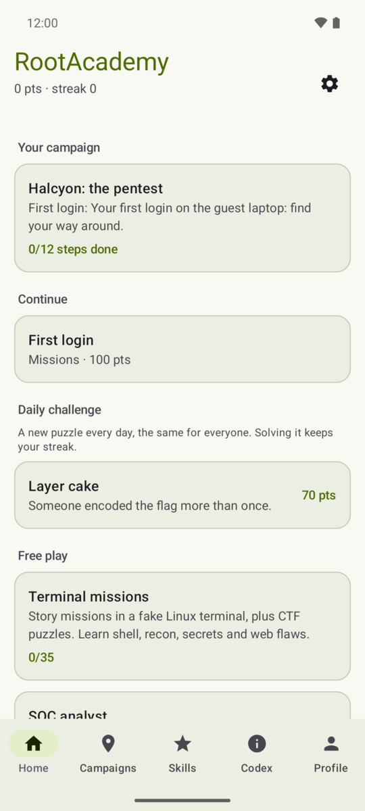
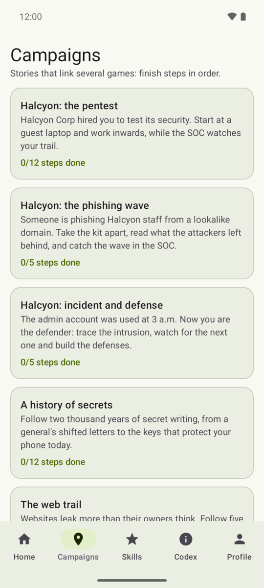
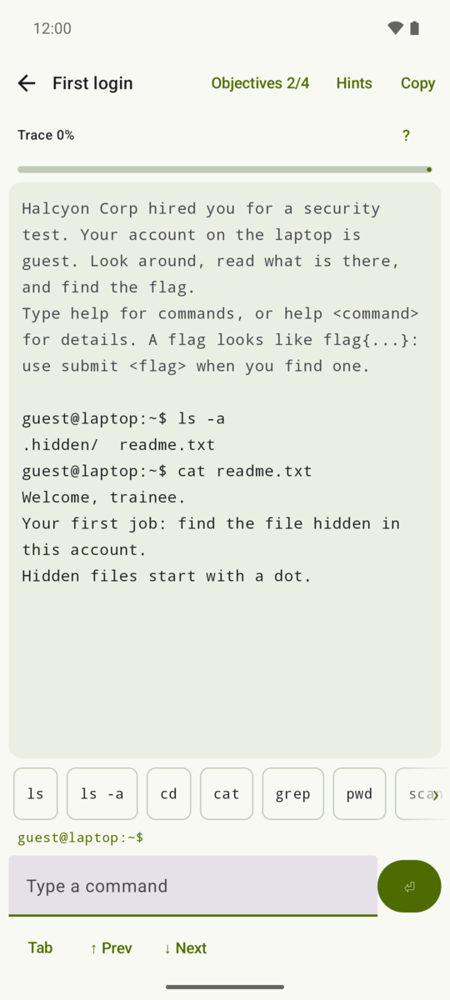
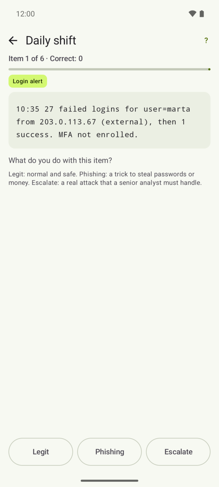
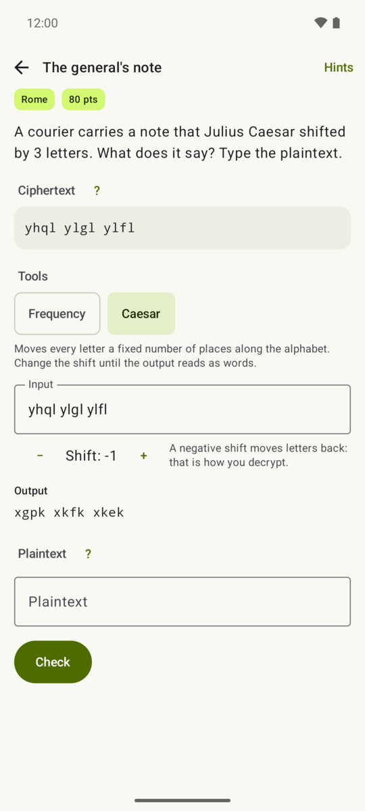
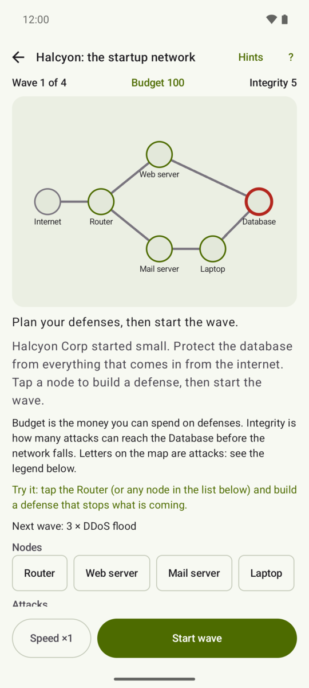

# Educational hacking game hub

Native Android app (Kotlin, Jetpack Compose, Material 3). Everything builds inside Docker; nothing but Docker
(and `make`) is needed on the host.

## Screenshots

| Home | Campaigns | Terminal missions |
|:---:|:---:|:---:|
|  |  |  |

| SOC analyst | Cipher Quest | Tower defense |
|:---:|:---:|:---:|
|  |  |  |

## Commands

```bash
make image      # build the dev image (once, and after Dockerfile changes)
make check      # unit tests, content packs (packcheck) and lint
make packcheck  # validate content/ and replay every mission solution
make dev        # debug APK in dist/<app>-<version>-<yyyymmddhhmm>.apk (versionName `<version>-YYYYMMDDHHmm`, versionCode `yyMMddHH`)
make install    # install on a device/emulator
make release    # signed APK and AAB (needs signing, see below)
make help       # every target
```

Without `make`: `docker compose run --rm dev ./gradlew :core:test testDebugUnitTest lint`.
CI runs the same targets with `RUN=` (no Docker wrapper).

Content packs are documented in [`docs/CONTENT.md`](docs/CONTENT.md); app UI conventions in
[`docs/APP_STANDARDS.md`](docs/APP_STANDARDS.md); the original plan is `Plan Root Academy game hub.md`.

## App parameters

The name, id and URL are build parameters. Precedence: `-P` Gradle property, then environment variable, then the
tracked `app.properties`, then the default in `app/build.gradle.kts`.

| Parameter | `app.properties` |
|---|---|
| `APP_NAME` | set in `app.properties` |
| `APP_ID` | set in `app.properties` |
| `APP_URL` | set in `app.properties` |
| `APP_VERSION_NAME` / `APP_VERSION_CODE` | not set (the release workflow sets them; defaults `0.1.0` / `1`) |

```bash
APP_NAME="My App" APP_ID=com.example.myapp make dev
```

## Release signing

Create a keystore inside the container (kept out of git) and `keystore.properties`:

```bash
docker compose run --rm dev bash -c '
  PW=$(head -c 24 /dev/urandom | base64 | tr -dc A-Za-z0-9 | head -c 24)
  keytool -genkeypair -keystore release.jks -alias release -keyalg RSA -keysize 4096 -validity 10000 \
    -dname "CN=Release" -storepass "$PW" -keypass "$PW"
  printf "storeFile=release.jks\nstorePassword=%s\nkeyAlias=release\nkeyPassword=%s\n" "$PW" "$PW" > keystore.properties'
```

Or pass `SIGNING_KEYSTORE`, `SIGNING_STORE_PASSWORD`, `SIGNING_KEY_ALIAS`, `SIGNING_KEY_PASSWORD` as environment
variables. A release build without signing details fails on purpose. Back up the keystore: losing it means you
cannot update an installed app.

## Releases

`.github/workflows/release.yml` tests, signs and builds the app on GitHub and publishes a GitHub Release.

1. Add repository secrets: `SIGNING_KEYSTORE_BASE64` (`base64 -w0 release.jks`), `SIGNING_STORE_PASSWORD`,
   `SIGNING_KEY_ALIAS`, `SIGNING_KEY_PASSWORD`.
2. Move the `Unreleased` entries in `CHANGELOG.md` under a new `## [x.y.z] - date` heading.
3. Tag and push: `git tag v1.2.3 && git push origin v1.2.3`. Pre-release tags (`v1.2.3-rc.1`, `-beta.N`, `-alpha.N`)
   create a GitHub pre-release.

### Release smoke test

CI runs `make r8` (R8 minification of the release variant) on every push, but cannot run the app. Before tagging,
install the signed release build and check: a terminal mission loads and completes, a puzzle and a SOC shift open
(content is parsed from JSON), progress export and import work, and the language switch works. The R8 rules
(`app/proguard-rules.pro`) rely on the consumer rules shipped by Room, Hilt, Compose and kotlinx.serialization.

Release tags use `versionName` `1.2.3+<sha>` and `versionCode = major*1000000 + minor*10000 + patch*100 + stage`
(minor and patch at most 99). The stage keeps pre-releases below the final release so the final installs as an update:
`alpha.N` = N, `beta.N` = 30+N, `rc.N` = 60+N (N up to 29), final = 99. So `v1.2.3-rc.2` is 1020362 and `v1.2.3` is
1020399. Non-tag CI builds use the run number as version code (dev builds only). The workflow refuses a tag that is not
on the default branch or while `[Unreleased]` in `CHANGELOG.md` still has entries.
